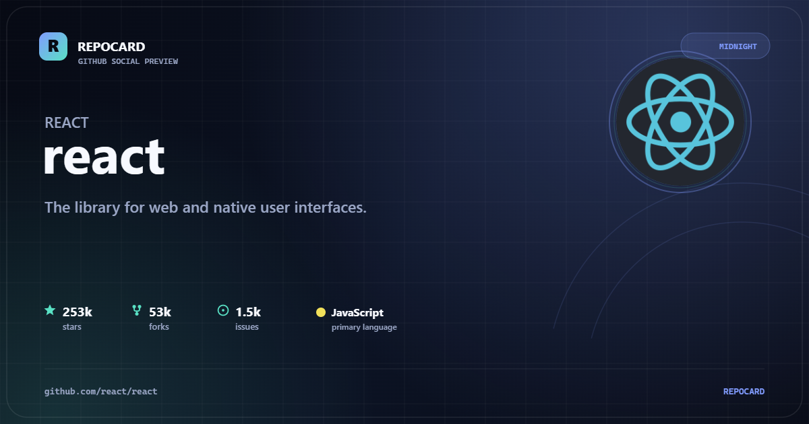
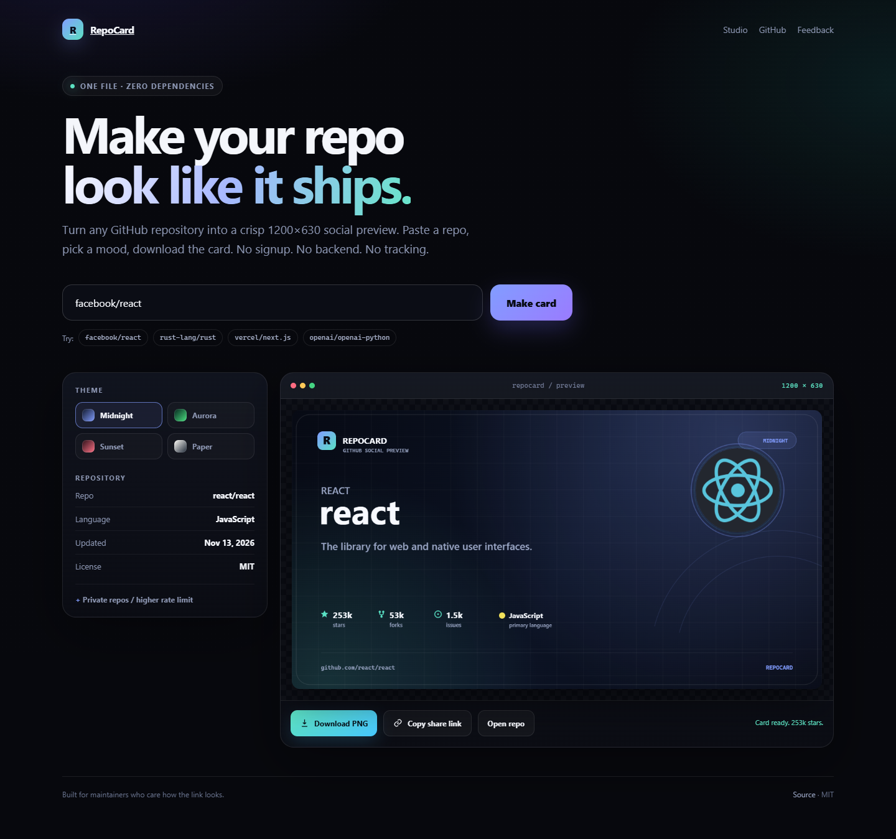

<div align="center">
  
  <h1>RepoCard</h1>
  <p><strong>Make your GitHub repo look like it ships.</strong></p>
  <p>Turn any public repository into a crisp 1200×630 social preview.<br>One file. Zero dependencies. No backend. No tracking.</p>

  [Live demo](https://angrystupid.github.io/repocard/) · [Report a bug](https://github.com/angrystupid/repocard/issues) · [Suggest a theme](https://github.com/angrystupid/repocard/issues)

  <br>

  
  
  
</div>

<br>



## The studio



## Why RepoCard?

Your repository already has a README, a logo, and a story. But when the link is shared on X, LinkedIn, Slack, or Discord, it often looks like a default grey box.

**RepoCard** turns `owner/repo` into a polished card in seconds:

- **1200 × 630** — the canonical social preview size
- **4 themes** — Midnight, Aurora, Sunset, Paper
- **Real repository data** — stars, forks, issues, language, license
- **One-click PNG export**
- **Shareable URL** — every card can be reopened with `?repo=owner/repo`
- **Private-ready** — add a personal token locally if you need it
- **No build step** — open `index.html` and it works

## Use it

1. Open the [live demo](https://angrystupid.github.io/repocard/).
2. Paste a repository such as `facebook/react`.
3. Pick a theme.
4. Download the PNG, or copy a share link.

You can also open a card directly:

```text
https://angrystupid.github.io/repocard/?repo=rust-lang/rust
```

## Run locally

```bash
git clone https://github.com/angrystupid/repocard.git
cd repocard
# open index.html in a browser — that is the whole setup
```

The app calls the public GitHub REST API. Unauthenticated requests are rate-limited to 60/hour per IP. Add a token in the settings panel for a higher limit or private repositories; the token stays in `localStorage` and is only sent to `api.github.com`.

## Design notes

- Canvas-first rendering so the preview is exactly the file you download.
- System fonts only, so the page stays instant and offline-friendly.
- Language colors follow GitHub's public linguist palette.
- The card is generated entirely in the browser. No image ever leaves your machine.

## Roadmap

- [ ] Custom accent color picker
- [ ] More card layouts (terminal, minimal, glass)
- [ ] Copy as Markdown / Open Graph image
- [ ] Team and organization cards

## License

MIT © [angrystupid](https://github.com/angrystupid)

